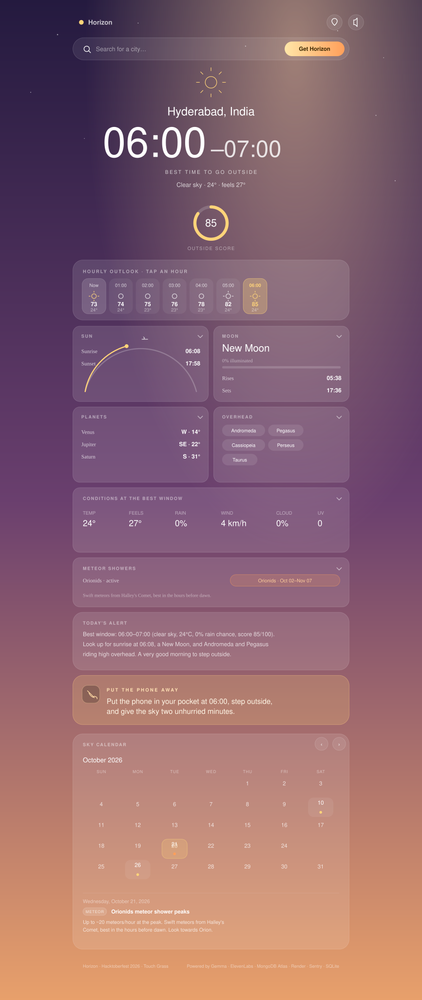

# 🌇 Horizon

[](https://github.com/your-user/horizon/actions/workflows/ci.yml)
[](LICENSE)
[](pyproject.toml)
[](#-tests)

**A daily outside alert & sky event planner.** Horizon tells you the best time
to step outside today, what interesting things are happening in the sky, and
then nudges you to put the phone away and actually go look.

It's built with the **"Touch Grass"** spirit: a short interaction that leads to
a real-world experience. Ask once, then leave your phone in your pocket.

> Submission for **Hacktoberfest 2026 — Open-Source AI Challenge, Week 1: Touch Grass.**



---

## ✨ What it does

- **Best weather window** — scores every 1–3 hour block of the day using
  [Open-Meteo](https://open-meteo.com/) data (temperature, rain chance, wind,
  cloud cover, UV) and picks the nicest window to be outside.
- **Sky events** — uses [Skyfield](https://rhodesmill.org/skyfield/) to compute,
  for your location: sunrise/sunset, civil twilight, moon phase + rise/set,
  visible bright planets, notable constellations high overhead, and any major
  meteor showers near their peak.
- **Sky calendar** *(planning view)* — the same Skyfield engine projects months
  ahead: new/full moons, equinoxes & solstices, major meteor-shower peaks and
  planet oppositions. Only *important* dates are highlighted, and each one opens
  a short explanation of what to look for.
- **Daily alert** — a warm, human message with the best window, key conditions,
  2–4 sky things to look for, and a short "put the phone away" nudge. Written by
  **Gemma** when available, or a clean built-in template when it isn't.
- **Spoken alert** *(optional)* — a short **ElevenLabs** narration you can play
  while you get ready to head out.
- **Location** — accepts a place name (city, town **or village**) or lat/long.
  Coordinates are *reverse-geocoded* so a GPS fix resolves to the actual village
  / neighbourhood name plus its full administrative hierarchy, elevation and
  timezone. All lookups are cached on disk.
- **Interface** — an immersive, sky-themed web app with a pair of genuinely
  *interactive* planning tools: a **sky calendar** that highlights only the dates
  worth planning around (new/full moons, major meteor peaks, equinoxes &
  solstices, planet oppositions) with tap-to-read details, and a tappable
  24-hour score strip plus detail tiles you can expand for sun, moon, planets,
  constellations and meteors. Ships with **dark and light themes** (tap the
  sun/moon in the top bar; the choice is remembered). Comes with an equally
  capable CLI.

---

## 🧱 Architecture

```
horizon/
├── horizon/
│   ├── agent.py        # orchestrates the pipeline (Sentry-traced)
│   ├── config.py       # all settings; every partner key is optional
│   ├── models.py       # Pydantic models (API + CLI + storage)
│   ├── geocode.py      # place -> lat/long + reverse geocode (cached, key-less)
│   ├── weather.py      # Open-Meteo fetch + explainable outdoor scoring
│   ├── sky.py          # Skyfield: sun, moon, planets, constellations, meteors
│   ├── events.py       # upcoming sky events for the calendar (Skyfield)
│   ├── llm.py          # Gemma: Ollama / OpenRouter / Google / HuggingFace
│   ├── narrator.py     # Gemma prompt + deterministic template fallback
│   ├── voice.py        # ElevenLabs text-to-speech
│   ├── news.py         # SerpApi sky-news enrichment
│   ├── storage.py      # MongoDB Atlas, with SQLite fallback
│   ├── main.py         # FastAPI app + web UI serving
│   ├── cli.py          # `python -m horizon.cli`
│   ├── static/         # index.html, style.css, app.js
│   └── data/           # meteor_showers.json
├── examples/           # sample text + markdown daily alert
├── tests/              # offline unit tests (83, ~95% coverage)
├── docs/               # DEV submission draft + submission checklist
├── .github/            # CI workflow, issue + PR templates
├── Makefile            # make run / test / lint / fmt
├── Dockerfile          # container for DigitalOcean / Render
├── render.yaml         # Render Blueprint
├── .do/app.yaml        # DigitalOcean App Platform spec
├── requirements.txt
└── .env.example
```

**Data flow:** `location → weather → sky → news → narration → (voice) → storage`
— each stage is wrapped in its own Sentry span.

---

## 🚀 Quickstart (local, 2 minutes)

```bash
# 1. Clone and enter
git clone <your-fork-url> horizon && cd horizon

# 2. Create a virtualenv
python -m venv .venv && source .venv/bin/activate

# 3. Install
pip install -r requirements.txt

# 4. (optional) configure partner tech
cp .env.example .env   # leave it empty for a working default experience

# 5. Run the web app
uvicorn horizon.main:app --reload
# open http://localhost:8000
```

The first sky calculation downloads the ~17 MB `de421.bsp` ephemeris into
`.cache/` (one time). No API keys are required for the core experience.

### Or use the CLI

```bash
python -m horizon.cli --city "Lisbon"
python -m horizon.cli --lat 48.85 --lon 2.35 --speak
python -m horizon.cli --city Pune --no-llm      # force the template narrator
python -m horizon.cli --city Tokyo --json       # machine-readable output
```

---

## 🤖 Enabling the partner technologies

Everything is auto-detected. Add what you have to `.env`; the app reports what's
active at **`GET /api/health`** and in the footer of the web UI.

### Best Use of Gemma (featured)
Horizon uses **Gemma** to turn raw weather + sky data into natural, friendly
daily alerts. Four providers are supported, in priority order:

```bash
# Option A — fully local & open (recommended, no key, no cost)
ollama pull gemma3:4b
# .env: LLM_PROVIDER=ollama

# Option B — hosted Gemma
# .env: LLM_PROVIDER=openrouter   OPENROUTER_API_KEY=...
# .env: LLM_PROVIDER=google       GOOGLE_API_KEY=...
# .env: LLM_PROVIDER=huggingface  HF_API_KEY=...
```

If no model is reachable, Horizon falls back to a deterministic template
narrator so the app always works.

### Best Use of ElevenLabs (partner)
Generates a short spoken version of the alert:

```bash
# .env: ELEVENLABS_API_KEY=...
python -m horizon.cli --city "Berlin" --speak
```
Audio is cached in `.cache/audio/` and served at `/audio/...`. In the web UI,
tick **"Spoken alert"**.

### Best Use of DigitalOcean / Best Use of Render (featured)
The app ships with a `Dockerfile` and deploy specs:

```bash
# Render
#   Push to GitHub -> New + -> Blueprint -> select render.yaml

# DigitalOcean App Platform
doctl apps create --spec .do/app.yaml

# Or plain Docker anywhere
docker build -t horizon . && docker run -p 8000:8000 --env-file .env horizon
```
Both specs expose `/api/health` as the health check.

### Best Use of MongoDB Atlas (partner)
Set `MONGODB_URI` and Horizon stores location preferences plus a rolling history
of generated alerts. Without it, it transparently uses a local SQLite file.
`Storage.search_history()` contains the extension point for **Atlas Vector
Search** (`$vectorSearch`) / Atlas Search (`$search`).

### Best Use of SerpApi (partner)
Set `SERPAPI_API_KEY` to pull recent astronomy headlines into the alert:

```bash
# .env: SERPAPI_API_KEY=...
```

### Best Use of Sentry (partner)
Set `SENTRY_DSN` to trace the whole agent: one transaction per alert with a span
per stage (location, weather, sky, news, narration, voice, storage) and captured
exceptions. Without it, no-op shims keep everything running.

---

## 🔌 API

| Method | Path           | Description                              |
|--------|----------------|------------------------------------------|
| `GET`  | `/`            | Web UI                                   |
| `GET`  | `/api/health`  | Service + integration status             |
| `POST` | `/api/alert`   | Build a daily alert (JSON body)          |
| `GET`  | `/api/alert`   | Build a daily alert (query string)       |
| `GET`  | `/api/geocode` | Resolve a place name (city/town/village) |
| `GET`  | `/api/events`  | Notable sky events for the calendar      |
| `GET`  | `/api/history` | Recent stored alerts                     |
| `GET`  | `/api/search`  | Search stored alerts (Atlas hook)        |
| `GET`  | `/api/stats`   | Storage backend statistics               |

```bash
curl "http://localhost:8000/api/alert?city=Lisbon&speak=true" | jq
curl "http://localhost:8000/api/events?days=90" | jq
```

Interactive docs at `http://localhost:8000/docs`.

---

## 🧪 Tests

The suite is **offline by default** — partner APIs are disabled and network
calls are monkeypatched — and runs in about a second:

```bash
pip install -e ".[dev]"        # runtime + pytest, pytest-cov, ruff
pytest                          # or: make test
pytest --cov=horizon            # with coverage (~95%)
```

The few Skyfield integration tests reuse the cached ephemeris
(`.cache/de421.bsp`, downloaded once) and skip cleanly when it is absent and the
machine is offline. Lint + format are enforced with `ruff`:

```bash
make lint   # ruff check . && ruff format --check .
make fmt    # auto-format
```

---

## 🖼️ Example output

See [`examples/sample_alert.txt`](examples/sample_alert.txt) and
[`examples/sample_alert.md`](examples/sample_alert.md). A condensed version:

```
HORIZON  ·  Hyderabad, India
Your best outside window is 04:00-07:00

Best window : 04:00 - 07:00 (score 87/100)
Weather     : Clear sky, 26°C, 0% chance of rain, wind 5 km/h, 0% cloud.
Sun         : up 06:08 / down 17:58
Moon        : New Moon (0% lit) — darkest skies of the month
Planets     : Mercury (WSW)
Look up for : Aquila, Lyra, Cygnus, Sagittarius, Pegasus

Put the phone in your pocket at 04:00, step outside, and give the sky
two unhurried minutes. No filters needed.
```

---

## 🏆 Partner categories this project enters

> Ready-to-paste wording for the DEV submission post lives in
> [`docs/DEV_SUBMISSION.md`](docs/DEV_SUBMISSION.md).

| Category | Where | How it's used |
|----------|-------|---------------|
| **Best Use of Gemma** (featured) | `horizon/llm.py`, `horizon/narrator.py` | Turns weather + sky facts into warm, human daily alerts (local via Ollama by default). |
| **Best Use of ElevenLabs** (partner) | `horizon/voice.py` | Narrates the alert so you can listen while getting ready to go out. |
| **Best Use of DigitalOcean** (featured) | `Dockerfile`, `.do/app.yaml` | Hosts the app; `/api/health` health check. |
| **Best Use of Render** (featured) | `Dockerfile`, `render.yaml` | Blueprint deploy path. |
| **Best Use of MongoDB Atlas** (partner) | `horizon/storage.py` | Stores location prefs + alert history; Vector Search hook. |
| **Best Use of SerpApi** (partner) | `horizon/news.py` | Adds rare sky-event / astronomy news to the alert. |
| **Best Use of Sentry** (partner) | `horizon/agent.py` | Agent tracing across every pipeline stage. |

The core app has **no required paid API** — open data (Open-Meteo + Skyfield) and
open-weight models (Gemma) drive everything.

---

## 🛠️ Configuration reference

All variables live in `.env` (see `.env.example`). Highlights:

| Variable | Default | Purpose |
|----------|---------|---------|
| `LLM_PROVIDER` | `auto` | `auto`/`ollama`/`openrouter`/`google`/`huggingface`/`none` |
| `OLLAMA_MODEL` | `gemma3:4b` | Local Gemma model |
| `ELEVENLABS_VOICE_ID` | `21m00Tcm4TlvDq8ikWAM` | Voice used for narration |
| `MONGODB_URI` | – | Enables Atlas storage |
| `SERPAPI_API_KEY` | – | Enables sky news |
| `SENTRY_DSN` | – | Enables tracing |
| `DEFAULT_LATITUDE` / `_LONGITUDE` | Hyderabad | Fallback location |

---

## 🔭 Future improvements

- **Proactive notifications** — push/web notification at the start of the best
  window (e.g. via a cron worker or ntfy.sh), instead of pull-only.
- **Telegram / WhatsApp bot** — "send me my Horizon" every morning.
- **Red-light night mode** — a dark-adapted UI theme for stargazing.
- **Aurora & ISS alerts** — integrate NOAA Kp index and ISS pass predictions.
- **Weather-aware rescheduling** — re-notify if the chosen window is clouded out.
- **iCal export** — drop the window into your calendar as an event.
- **Atlas Vector Search** — semantic search over past alerts ("what did I see
  during last month's meteor shower?").
- **Multi-day planner** — best window across the coming week, plus a "sky
  forecast" of upcoming events.
- **Golden-file tests** — snapshot the real ephemeris output for a set of
  cities/dates to catch astronomy regressions.

---

## 🤝 Contributing

Contributions are welcome and genuinely appreciated — from typo fixes to new
astronomy data. Start with [`CONTRIBUTING.md`](CONTRIBUTING.md); good first
tasks are labelled
[`good first issue`](https://github.com/your-user/horizon/labels/good%20first%20issue).
If you're preparing the challenge entry itself, follow
[`docs/SUBMISSION_CHECKLIST.md`](docs/SUBMISSION_CHECKLIST.md).

This project follows the [Contributor Covenant](CODE_OF_CONDUCT.md) and a
[security policy](SECURITY.md).

---

## 📄 License

MIT — see `LICENSE`.
